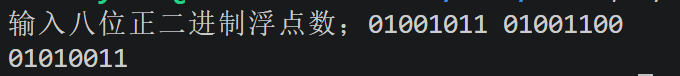

# step1
1. 按无符号数解析，甜度为156，相当于直接将二进制转化为十进制。
2. 按有符号数解析，甜度为-100，第一个1是符号位表示其为负数，直接算其转化的十进制后减去2的8次方，或者取反后加1，得相应负数。
3. 为了方便计算。计算机不能直接做减法，做减法需要将减数转变使其变为加法，即采用补码的方式存储和计算负数。该负数对应的正数取反再加1即得到补码，正数则没有变化，通过补码可以直接实现减法的运算，不用再重新设计专门做减法硬件设备。原码和反码是帮助人们理解和推导的，真正计算用的还是反码。
4. 会输出[警告!] 温度过高！触发消防喷淋系统！这行字，原因在于有符号数与无符号数相比较时有符号数会隐式转换成无符号数，但编译器并不会报错。这导致如果比较的有符号数是负数的话，它会转变成有符号数，此时-10会转变成2^32-10,比较的时候就是拿这个数与50比较，显然这个数比50大，所以输出警告。底层在于解释规则不同，有符号数二进制最高位1表示符号位，用无符号数来解释的话最高位的1代表2的32次方，解释方式不同自然比较的数不同。
# step2
1. 保存的二进制为10011001。
2. 有-103颗珍珠，是正溢出
3. 
```c
// 若相加不发生溢出返回 1，发生溢出返回 0
int is_safe(int x, int y) {

    int sum = x + y;
    int x_sign = (x >> 31) & 1;
    int y_sign = (y >> 31) & 1;
    int sum_sign = (sum >> 31) & 1;//得到该数二进制的符号位
    int rusult;

    // 请补全代码写在TO DO与END OD TO DO之间：
    //TO DO
    if (x_sign==0&&y_sign==0&&sum_sign==1||x_sign==1&&y_sign==1&&sum_sign==0)
    {
        return 0;
    }
    else
    {
        return -1;
    }

    //END OF TO DO

    return  result;
}
```
* 如果这两个数的最高位都是0，即都是正的，加起来得到的数最高位是1，即是个负的，显然发生了正溢出，其中sum=x+y-2^8。同理两个数都是负的加起来确是正的，则发生负溢出，sum=x+y+2^8。
4. 
```c
int final_milk(int x) {

    int y;

    // 请补全代码写在TO DO与END OD TO DO之间：
    //TO DO
    y=(x<<4)+(x<<3)+(x<<2)+x;//左移n位相当于乘以2的n次方，改行代码相当于x乘以16加x乘以8加上x乘以4最后加x，即x乘以29
    //END OF TO DO

    return y;
}
```
# step3
### 3.1
1. float类型用1位表示符号，8位表示阶码，23位表示尾数（实际精度是24，规格化数省略了最左边的1），共32位。double类型用1位表示符号，11位表示阶码，52位表示尾数，共64位。
2. 对于float而言，偏置值为2的7次方-1即127，而对于double类型而言偏置值等于2的10次方减1即1023。算存码阶数时实际指数要加上偏移值，算实际指数时要将存码阶数减去偏移值。这样做是为了方便存负指数。由于阶码是无符号的只能存正数，要存负的指数就必须转化成正的。这里以float为例，8位的话原本能存0到255这256个数，除去0和255这两个表示特殊作用的数，即1到254这244个数有意义，为保证对称，减去127即代表其实际指数，这就是为什么偏置值是127。
3. 非规格化数即阶码全为0，固定指数为最小值即为2的-126次方。与规格化数不同，它的隐含尾数为0，而规格化数隐含位为1。它的作用是表示非常接近0的数，填补规格化数与0之间的间隙。为了保证无缝衔接，固定指数为2的-123次方，保证非规格化数的最大值等于规格化数的最小值。同时非规格化数越靠近0，精度越低，本质上是牺牲精度换范围。非规格化数表示的最小值为2的-23次方乘以2的-126次方即2的-149次方（针对单精度而言）。
4. 阶码全为 1 且尾数全为 0代表无穷大，符号位为1代表负无穷大，为0代表正无穷大，当除数为0或浮点数溢出时产生。阶码全为 1 且尾数非0代表NAN，即不是一个有效的数，例如0除以0，无穷大减无穷大时会产生。尾数位最高位为1为安静NAN，编译不报错，最高位为0为信号NAN，编译时报错。很特殊的地方在于NAN是唯一不等于自身的值，即NAN！=NAN。
### 3.2
* A非规格化 B1-7=-6 C0.011=0.25+0.125=0.375 D0.375×2^-6=3×2^-9。  
* E特殊值  
* F9-7=2 G1.010=1.25 H1.25×2^2=5
### 3.3
1. 最小非规格化正数对应的二进制模式为00000001，对应十进制为2^-3*2^-6=2^-9。最大的二进制为00000111，对应十进制为7乘以2的-9次方。
2. 最大的对应规格化数二进制为01110111，对应十进制为1.875乘以2的7次方。最小二进制为00001000，十进制为1乘以2的-6次方。
3. 是为了保证非规格化数与规格化数的衔接，非规格化数本身就是为了填补最小规格化数与0之间的空隙。就八位而言，最大正非规格化数与最小正规格化数还是有一点差距，这是由于尾数太少精度太低，换成32位便特别接近。但如果非规格化数的实际指数为-Bias，差的会更多。此时最大非规格化正数为7乘以2的-10次方，与最小规格化正数2的-6次方差的更多，这与非规格化数设计本身的作用相违背，所以直接将非规格化数的实际指数设为1-Bias，减小两者间的衔接差距。
# step4
1. 为什么对阶是小阶向大阶看齐，原因在于小阶向大阶看齐尾数右移，这样丢的是最低位，由于该数本身很小，丢了最低位造成的影响也很小。但大阶向小阶看齐不同，尾数左移，丢的是高位，造成的影响很大，误差也很大。所以为了减小误差，选择小阶向大阶看齐。
```c
#include<stdio.h>
int m(char *s)//读取二进制的函数
{
    int val=0;
    for(int i=0;s[i]!='\0';i++)
    {
        val=val<<1;//先移动1位
        if(s[i]=='1')//是1的话当位为1
        {
        val|=1;
        }
    }
    return val;
}
int main(void)
{
    char s1[10],s2[10];//存二进制的数组
    printf("输入八位正二进制浮点数；");
    scanf("%s%s",s1,s2);
    int a=m(s1);//得到二进制数
    int b=m(s2);
    int n=(a>>7)&1;//符号位
    int a1=a&((1<<3)-1);//尾数
    int b1=b&((1<<3)-1);
    int Ea=(a>>3)&((1<<4)-1);//阶数
    int Eb=(b>>3)&((1<<4)-1);
    int fulla=(1<<3)|a1;//加上隐含位
    int fullb=(1<<3)|b1;
    int m,sum,final;
    //小阶对齐大阶
    if(Ea<=Eb)
    {
        m=Eb-Ea;
        sum=(fulla>>m)+fullb;//尾数相加（移位后的）
        final=Eb;
    }
    else
    {
        m=Ea-Eb;
        sum=(fullb>>m)+fulla;
        final=Ea;
    }
    while(sum>=(1<<4))//规则化，如果进了第5位则右移阶数加1
    {
        sum=sum>>1;
        final=final+1;
    }
    int new=sum&((1<<3)-1);//去掉隐含位
    int c=(n<<7)|((final&(((1<<4)-1)))<<3)|new;//得到新的二进制数
    for(i=7;i>=0;i--)//打印该二进制数
    {
        if(c&(1<<i))
        printf("1");
        else
        printf("0");

    }
    printf("\n");
return 0;
    

}
```

* 要实现计算两个二进制的和，首先应该想怎么读取这两个二进制，不能直接用scanf读，如果这样就不能读到最高位的1了，所以靠字符串数组来读，把数字当作字符，再循环打印出来，得到的就是一串真正存在计算机内部的二进制，然后赋给相应整数。首先我们把这个整数剥离开来，分为符号位阶数和整数，注意这是再计算机内部，实际表现出来的还是其对应的整数。取出来后我们还需要将尾数最前面加上隐含位1，然后进行相加，得到sum并对齐规则化，右移并阶数加1。最后我们把这些符号位阶数尾数拼起来（注意去掉隐含位），这样我们得到的c就是相应二进制的数。但printf只能打印其对应的整数，所以我们还需要循环将这个数的二进制打印出来，才能显示二进制数。
2. 浮点数的加减法不满足结合律，原因在于当一个很大的数加上或减去一个很小的数，很小的数就被忽略了。他们的阶数相差太多，很小的数要右移很多位，当超过23位时最高位都被忽略了，尾数全部被挤了出去，相当于0，直观看来小数被大数吃掉了。原因在于尾数位数有限，精度有限，相差太大精度就丢失了。为了避免这样应该尽量避免大数与小数之间进行运算。但浮点数加减法满足交换律。

